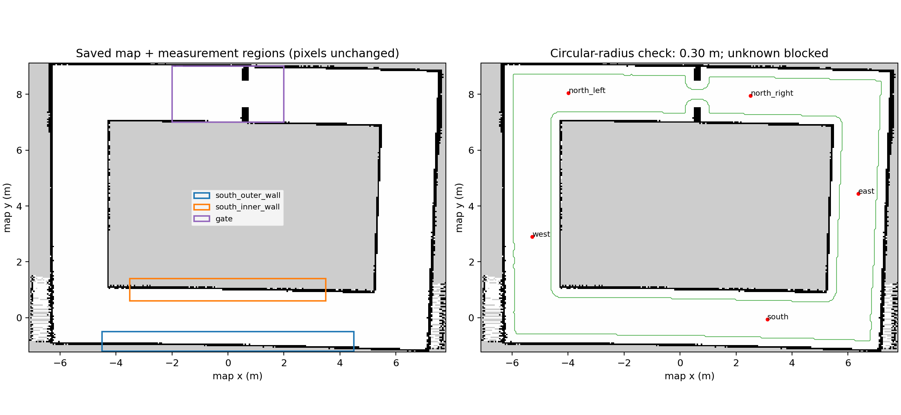
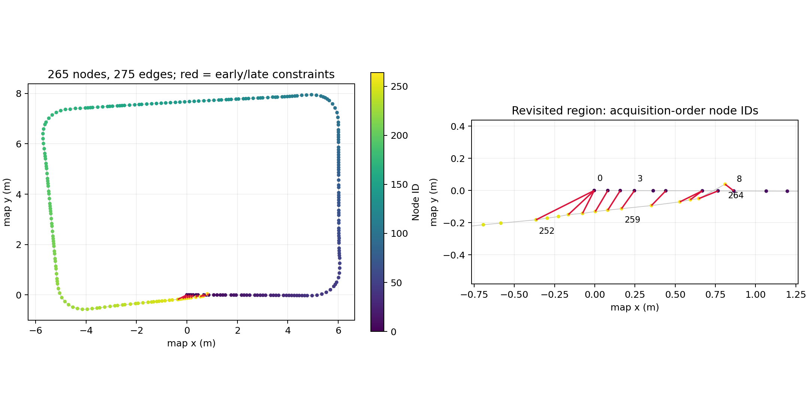

# M3-2｜激光 SLAM 建图与地图质量评估

运行及独立验证日期：2026-11-14；文档整理日期：2026-11-15。正式数据为 `mapping_02`，对应巡场记录 `results/route_run_02.csv`。本说明依据仓库提交 `c1209099cd0044acb259cfff2cc256f0a87a7548` 的代码和数据整理。

本题使用自建环形走廊、提供的阿克曼小车与 `slam_toolbox` 完成建图。已经完成巡场、rosbag 记录、地图保存与重新加载、墙直线度测量、重影筛查、位姿图重访约束检查和静态通行性评估。单参数对比实验未做，属于原题选做；实际 Nav2 导航留到 M3-3。

## 1. 结果与交付位置

| 项目 | 本次结果 | 文件 |
| --- | --- | --- |
| 地图 | 298 × 207 格，0.05 m/格 | [map.yaml](maps/map.yaml)、[map.pgm](maps/map.pgm) |
| 南侧外墙中央直线段 | RMS 2.43 cm，最大法向残差 4.93 cm | [质量报告](results/quality_report.md)、[墙线评估图](results/wall_straightness.png) |
| 南侧内墙中央直线段 | RMS 2.90 cm，最大法向残差 6.28 cm | 同上 |
| 回环区域墙线 | 36 段中，符合当前双占据带判据的为 0 段 | [统计表](results/quality_metrics.csv) |
| 位姿图 | 265 节点、275 条边，其中 11 条连接早期与末期观测 | [位姿图报告](results/pose_graph_report.md)、[全部连接](results/pose_graph_edges.csv) |
| 窄门 | 最小连续自由宽度 0.95 m，19 格 | [窄门评估图](results/gate_width.png) |
| 保守通行性 | 圆形半径 0.30 m、未知区域按障碍处理时，走廊代表点连通，门口局部连通 | [总览图](results/map_quality_overview.png) |
| 巡场 | CSV 时长 199.10 s，最大参考路线跟踪误差 3.25 cm | [巡场记录](results/route_run_02.csv)、[轨迹图](results/route_coverage.png) |
| 正式录包 | 270.953 s，68,226 条消息，SQLite 检查 `ok` | [录包元数据](bags/mapping_02/metadata.yaml)、[数据库](bags/mapping_02/mapping_02_0.db3) |

墙线残差包含栅格厚度、量化及建图不一致，不能直接当成纯定位误差。巡场 CSV 中约 0.15 m 的首末距离来自脚本停车容差及最后记录时刻，也不能作为真实车身闭环漂移。



## 2. 自建世界与难点

场景文件为 [worlds/scene.world](worlds/scene.world)，使用自行设置的墙体与地面，没有使用官方示例世界。

| 几何项 | 世界坐标中的设计 |
| --- | --- |
| 外墙内侧边界 | `x = ±7 m`，`y = ±5 m` |
| 中央岛外侧边界 | `x = ±5 m`，`y = ±3 m` |
| 普通走廊 | 净宽 2 m；南北两侧沿中央岛有 10 m 连续直线段，满足 ≥8 m 的要求 |
| 墙体 | 厚 0.20 m，高 1.50 m |
| 回环 | 沿中央岛外侧绕行，回到南侧已经建图的区域 |
| 自定难点 | 北侧走廊 `x≈0` 处设置两段门柱，留下 `y=3.5–4.5 m` 的 1 m 净开口 |
| 出生点 | `(x, y) = (0, -4) m`，朝向 `+x` |

**难点目的：** 检查门柱边缘的测量噪声、定位不一致和栅格量化是否让狭窄通道变窄、出现伪障碍或被封闭。本场景采用普通 Gazebo 射线雷达，没有建立玻璃穿透或多径反射模型，因此不把现象解释成真实雷达多径。

**预期与实际：** 设计门宽 1.00 m；0.05 m 分辨率下名义上约为 20 格。保存地图中测得最小连续自由宽度为 19 格，即 0.95 m，比设计窄 1 格；不能将这 5 cm 全归因于 SLAM 漂移，因为还包含栅格化影响。门口没有封死，在半径 0.30 m 的保守圆形包络检查下仍可通过。最终地图在外墙附近保留了条纹状零散区域，未通过修图去除。

## 3. 小车复用、输入与坐标系

M3-2 通过包名复用 [M3-1 的 smart_car_description](../M3-1/src/smart_car_description)，包含小车、雷达、ros2_control 和控制器配置；本题新建世界、启动文件、SLAM 配置和巡场/评估程序。复用依赖在第 5 节提供构建方法，不依赖他人机器上的既有 `install/` 目录。

| 接口 | 用途 |
| --- | --- |
| `/cmd_vel`，`geometry_msgs/msg/Twist` | 巡场脚本发送车体线速度与角速度 |
| `/scan`，`sensor_msgs/msg/LaserScan` | SLAM 的激光观测，`frame_id=lidar_link` |
| `/odom`，`nav_msgs/msg/Odometry` | 巡场反馈；对应 `odom → base_footprint` 的里程计关系 |
| `/tf`、`/tf_static` | 里程计及机器人关节/传感器坐标变换 |
| `/clock` | 仿真时间；SLAM、RViz 和运动脚本使用仿真时钟 |
| `/map`，`nav_msgs/msg/OccupancyGrid` | SLAM 输出的占据栅格地图 |

主要变换链为 `map → odom → base_footprint → base_link → lidar_link`。`map → odom` 由 SLAM 提供，其余来自控制器和 `robot_state_publisher`。算法使用激光与里程计 TF 进行建图；`/odom` 同时供巡场和复盘使用。

雷达参数按仓库 Xacro：360 个采样点，10 Hz，范围 0.12–8.0 m，高斯测距噪声标准差 0.01 m。Xacro 中扫描角写为 `0–6.28 rad`，近似一周，角步长约 1°；程序根据消息角度字段计算并归一化前方扇区，不假定 `angle_min=-π`。

`check_car_pose.py` 和 `gz model -m smart_car -p` 仅用于诊断出生姿态。新场景没有加载发布 `/gazebo/model_states` 的状态插件；当前巡场、SLAM 和地图评估均不靠该话题修正地图，亦未将 Gazebo 真值作为地图位姿输入。

## 4. SLAM 与巡场参数依据

完整配置为 [config/slam_params.yaml](config/slam_params.yaml)。它基于 Humble 的在线异步配置，实际使用如下设置：

| 参数 | 值 | 依据 |
| --- | --- | --- |
| `mode`、`use_sim_time` | `mapping`、`true` | 在线建图，时间与 Gazebo 一致 |
| `odom_frame`、`base_frame`、`map_frame` | `odom`、`base_footprint`、`map` | 与现有 TF 对齐，雷达安装关系由 TF 查询 |
| `resolution` | 0.05 m | 当前十余米场景尺寸适中；1 m 门宽约 20 格，便于量化通道余量。更细分辨率未做对比，不声称本值最优 |
| `min_laser_range`、`max_laser_range` | 0.12、8.0 m | 匹配雷达有效范围，不按模板的 20 m 处理 |
| `minimum_time_interval`、`throttle_scans` | 0.1 s、1 | 允许接收约 10 Hz 的观测；实际接纳关键帧仍受运动和匹配条件约束 |
| `minimum_travel_distance` | 0.10 m | 比模板 0.5 m 更密，保留低速巡场与门口的局部几何 |
| `minimum_travel_heading` | 0.10 rad | 比模板 0.5 rad 更密，保留转角过程 |
| `map_update_interval` | 2.0 s | 比模板 5 s 更便于观察更新，不等于关键帧处理频率 |
| `do_loop_closing` | `true` | 允许在返回已建图区域时建立重访约束 |
| `loop_search_maximum_distance` | 3.0 m | 保留模板候选搜索半径，覆盖返回起点附近的重访；与开启回环配合使用，不将搜索范围设为整个世界 |
| Ceres 求解器与相关搜索/匹配接受阈值 | 见 YAML | 初次实验保留 Humble 模板值，避免同时放宽多个接受阈值。当前结果足以进行本题评估，没有证据表明需要继续调参；不声称这些默认值在其他场景同样最优 |

直线速度 0.25 m/s，转弯和窄门附近 0.12 m/s。按 10 Hz 计算，分别约为 2.5 cm/帧、1.2 cm/帧，均小于 5 cm 的地图格宽，降低相邻扫描间的运动量。

[drive_route.py](scripts/drive_route.py) 用 `/odom` 做纯追踪：以初始里程计位姿建立局部坐标，沿约 12 × 8 m、圆角半径 1 m 的闭合参考路线运行。前视距离 0.40 m，曲率绝对值限制约 `1/0.65 m⁻¹`；没有阿克曼原地转向。前方 ±20° 的有效激光最小距离小于 0.45 m、参考路径偏差超过 0.45 m、激光或里程计接收中断超过 3 秒墙钟时间，以及仿真时钟异常/超时都会终止运行并尝试发送零速度。该阈值停车用于本场景试跑保护，不是完整的避障规划。

程序在接近路径末端且距起点约 0.15 m 内结束。CSV 记录发生在正常运动循环，未包含最终停车事件，因此 `Loop complete` 需从终端确认。重新尝试一圈应从重新启动的仿真起点开始，不在中途停车位置直接重跑。

### 两处实现修正

1. **继承 M3-1 的轮序兼容修正。** 实测控制器版本为 Humble `ackermann_steering_controller 2.54.1`。前、后轮列表均采用“右、左”顺序，以修复原配置下左右转向角对应异常；轴距 0.28 m、轮距 0.18 m、轮半径 0.05 m 未因此改变。M3-2 复用该已修正模型包，不额外复制一套配置。
2. **出生高度由 0.15 m 改为 0.065 m。** 首次失败试跑中实际车头约偏 21.6°，而里程计仍接近零，直线行驶后触发前方距离停车。不能仅凭里程计零朝向判断车头与走廊对齐。按模型几何，轮底比 `base_footprint` 低约 0.06 m，故改为高出接触面约 5 mm 出生，减小落地扰动。重新启动后实际位置约 `(0.0031, -3.9992) m`，yaw 约 0.00134 rad（0.077°），第二次巡场完成。该对照支持修正有效，但未单独证明初次偏航的全部物理成因。

## 5. 环境与首次构建

基础环境：Ubuntu 22.04、ROS 2 Humble、Gazebo Classic。使用已配置 ROS 环境的系统 Python；分析脚本本身不需要启动 ROS。`slam_toolbox` 的准确安装版本未单独记录，可用 `ros2 pkg xml slam_toolbox` 在现场查询。

在已安装 ROS 2 的系统上，缺少依赖时安装：

```bash
sudo apt update
sudo apt install ros-humble-slam-toolbox ros-humble-nav2-map-server ros-humble-gazebo-ros-pkgs ros-humble-gazebo-ros2-control ros-humble-ros2-controllers ros-humble-xacro ros-humble-robot-state-publisher ros-humble-rviz2 python3-colcon-common-extensions python3-numpy python3-scipy python3-matplotlib python3-pil python3-yaml
```

已在当前 Python 中安装这些分析库也可继续使用；先验证导入，避免安装到另一个环境：

```bash
python3 -c "import numpy, scipy, PIL, yaml, matplotlib; print('analysis dependencies OK')"
```

以下假定仓库位于 `~/code/22SmartCar`，放在其他位置时替换该根路径。新克隆的仓库先构建共享的小车包：

```bash
source /opt/ros/humble/setup.bash
cd ~/code/22SmartCar/M3/M3-1
colcon build --packages-select smart_car_description
source install/setup.bash
```

M3-2 的场景和启动文件直接通过路径读取，修改它们不需要再 `colcon build`；修改 M3-1 的模型/控制器配置则需要重新构建共享包。

## 6. 已有成果的快速复现

**只重算当前交付数据，不开 Gazebo，不重新跑车：**

```bash
cd ~/code/22SmartCar/M3/M3-2
python3 scripts/eval_map.py --map maps/map.yaml --route results/route_run_02.csv --graph results/pose_graph_full.yaml --out results
```

输出包括 `quality_report.md`、`quality_metrics.csv/json`、`regions_used.json`、墙线/窄门/通行性/轨迹图，以及 `pose_graph_report.md`、`pose_graph_metrics.json`、`pose_graph_edges.csv` 和位姿图。

若只检查图结构：

```bash
python3 scripts/eval_pose_graph.py --graph results/pose_graph_full.yaml --out results
```

两个评估脚本必须同时保留在 `scripts/` 中。默认测量框针对本次场景与坐标约定；处理其他地图或坐标偏移较大的新运行，应先查看原图并用 `--regions` 提供调整后的 JSON，不能套用框选到转角后把它误算成墙线误差。

## 7. 从头运行一次建图

先停止旧的巡场、SLAM 和 Gazebo。以下使用新的 `repro_01` 名称，避免覆盖已交付的正式数据；若目录或 CSV 已存在，改用新的编号。

**每个新 ROS 终端先执行：**

```bash
source /opt/ros/humble/setup.bash
source ~/code/22SmartCar/M3/M3-1/install/setup.bash
cd ~/code/22SmartCar/M3/M3-2
```

### 7.1 启动世界与检查起点（终端 A）

```bash
mkdir -p results/repro_01 maps/repro_01 bags
ros2 launch ./sim.launch.py
```

终端 A 保持运行。小车停稳后，在空闲终端检查：

```bash
gz model -m smart_car -p
ros2 topic echo /odom --once
ros2 topic hz /scan
```

`gz` 输出依次为 `x y z roll pitch yaw`，角度为弧度。预期世界位置接近 `(0,-4)`、yaw 接近 0；里程计位置也应接近其新建起点。雷达约 10 Hz，频率检查按 Ctrl+C 结束。若实际车身已经朝偏或滑到墙边，先排查起点，不能用放宽停车阈值掩盖问题。

### 7.2 启动 SLAM（终端 B）

```bash
ros2 launch slam_toolbox online_async_launch.py use_sim_time:=true slam_params_file:=$HOME/code/22SmartCar/M3/M3-2/config/slam_params.yaml
```

保持运行，在另一空闲终端确认已收到非零尺寸局部地图：

```bash
ros2 topic echo /map --once --field info
```

可选开启 RViz：

```bash
rviz2 --ros-args -p use_sim_time:=true
```

设置 Fixed Frame=`map`，视图用 `TopDownOrtho`，添加 `/map` 和 `/scan`；LaserScan 订阅使用 Best Effort。此时只有出生点周围局部地图是正常现象。

### 7.3 先录包，再巡场（终端 C、D）

终端 C：

```bash
ros2 bag record -o bags/mapping_repro_01 /scan /odom /tf /tf_static /clock /cmd_vel /map
```

看到开始记录后，终端 D：

```bash
python3 scripts/drive_route.py --out results/repro_01/route.csv
```

观察终端和仿真，出现 `Loop complete` 后等待约 10 秒让地图更新，再在终端 C 按 Ctrl+C 停止录包。若出现 `STOPPED`，先保存 CSV 和报错、检查现场，不在原地直接重新启动路线。

### 7.4 保存地图与位姿图

保持 SLAM 和 Gazebo 运行：

```bash
ros2 run nav2_map_server map_saver_cli -f maps/repro_01/map --fmt pgm --free 0.196 --occ 0.65 --ros-args -p use_sim_time:=true -p save_map_timeout:=10.0
ros2 topic echo /slam_toolbox/graph_visualization --once --full-length > results/repro_01/pose_graph_full.yaml
ros2 service call /slam_toolbox/serialize_map slam_toolbox/srv/SerializePoseGraph "{filename: '$PWD/maps/repro_01/posegraph'}"
```

地图应保存为 `.pgm` 和 `.yaml`，原生序列化返回 `result=0` 时成功，产生 `.data` 与 `.posegraph`。导出图时必须带 `--full-length`；默认数组截断会在 YAML 中留下 `...`，导致后面的边缺失。原生位姿图用于保留重建/继续建图信息，标准地图仍是 `map.pgm + map.yaml`。

### 7.5 运行评估

```bash
python3 scripts/eval_map.py --map maps/repro_01/map.yaml --route results/repro_01/route.csv --graph results/repro_01/pose_graph_full.yaml --out results/repro_01
```

这是新运行的结果，应检查其测量框、图像和数据，不能自动沿用第 8 节中 `mapping_02` 的验证结论。对新输出补做下面的地图加载与录包检查即可形成新一轮记录。

## 8. 独立验证记录

以下记录针对 2026-11-14 的正式数据 `mapping_02`，不是评估脚本自动执行的步骤。

### 8.1 地图重新加载：已通过

在已加载 ROS 环境的终端启动独立地图服务器：

```bash
ros2 run nav2_map_server map_server --ros-args -r __node:=saved_map_check_server -p yaml_filename:=$HOME/code/22SmartCar/M3/M3-2/maps/map.yaml -p topic_name:=/saved_map_check -p use_sim_time:=true
```

保持该终端运行；在另一终端配置、激活并读取：

```bash
ros2 lifecycle set /saved_map_check_server configure
ros2 lifecycle set /saved_map_check_server activate
ros2 topic echo /saved_map_check nav_msgs/msg/OccupancyGrid --once --field info --qos-reliability reliable --qos-durability transient_local --qos-history keep_last --qos-depth 1
```

实测读取结果：分辨率约 `0.05`，width=`298`，height=`207`，origin=`[-7.11,-1.23,0]`，与保存文件一致。地图服务器能正确解析 YAML 和图像并发布地图。若 echo 等待，先检查生命周期是否为 `active`，并使用上述持久化订阅 QoS。

### 8.2 录包结构与数据库：已通过

```bash
ros2 bag info bags/mapping_02
```

| 话题 | 消息数 |
| --- | ---: |
| `/scan` | 2,705 |
| `/odom` | 13,523 |
| `/tf` | 35,191 |
| `/tf_static` | 1 |
| `/clock` | 2,705 |
| `/cmd_vel` | 13,965 |
| `/map` | 136 |
| 合计 | 68,226 |

元数据时长 270.953468199 s，数据库 41,103,360 bytes，SQLite `PRAGMA quick_check` 返回 `ok`；实际数据库中逐话题计数与元数据一致。约 271 s 的录制覆盖约 199 s 的运动记录，且多出的时间包含运动前后阶段；两者分别来自 bag 接收时间和 CSV 仿真时间，不能当作同一时间基准直接计算控制延迟。

可用下面的只读命令复核数据库：

```bash
python3 - <<'PY'
import sqlite3
from pathlib import Path
path = Path('bags/mapping_02/mapping_02_0.db3').resolve()
con = sqlite3.connect(f'file:{path}?mode=ro', uri=True)
print('quick_check:', con.execute('PRAGMA quick_check').fetchone()[0])
for row in con.execute('SELECT t.name, COUNT(m.id) FROM topics t LEFT JOIN messages m ON m.topic_id=t.id GROUP BY t.id'):
    print(row)
con.close()
PY
```

这些检查验证数据库结构与消息计数，没有声称逐帧标注了所有激光观测的物理正确性。当前原始 bag 足以保留 `/scan`、`/odom`、TF 等要求的数据；本次未用回放替代现场建图结果。

### 8.3 重访约束：已验证图结构证据

完整 MarkerArray 中有 265 个节点（ID 0–264）、275 条唯一边。264 条边连接相邻节点；其余 11 条为：

`0→252`、`0→255`、`0→256`、`1→257`、`2→258`、`3→259`、`5→260`、`6→261`、`6→262`、`7→263`、`8→264`。

这些连接把采集序列的早期和末期联系起来，图为一个连通分量，独立环数 `E−N+C=11`。端点坐标与节点匹配误差为 0，支持重访区域已经加入跨时序图约束。没有执行人工闭环编辑。

MarkerArray 不包含约束的类型、求解残差或内部函数调用记录，因此不把它进一步描述成“已验证某个内部回环检测回调”。`quality_metrics.json` 中旧命名字段 `loop_closure_activation_verified=false` 指这层内部调用未验证；图结构层面的实际结果看 `revisit_constraints_verified=true` 和 `graph.early_late_edges=11`，两者不要混为“没有回环证据”。



## 9. 三组质量证据的解释与局限

1. **墙直线度：** 对指定中央直线段内全部占据像素中心做正交最小二乘拟合，报告 RMS、最大绝对法向残差及中央 90% 带宽。未对地图滤波或删去测量框内离群像素。早期候选框包含内墙转角得到约 0.37 m 残差，核对原图后缩到中央直线段；该数值不作为 SLAM 误差。
2. **回环一致性：** 在重复观测的南侧外墙中央段按 0.25 m 分段，共 36 段。双带判据要求每带至少 2 个占据像素、带间至少一空法向格、中心间距至少 2 格（0.10 m）；没有检出符合此判据的双带。外墙中央 90% 法向带宽约 0.0774 m，是最终占据带宽，不是两次扫描的配准间距。结合第 8.3 节的 11 条跨时序约束，可提供重访区域地图一致性的图和定量证据，但不能声称“墙间距严格为零”或排除所有亚栅格漂移。
3. **地图可用性：** 窄门 19 格大于原题要求的 3 格。评估圆形半径 0.30 m 大于车体平面包围半径约 0.251 m，留有约 5 cm 余量；距离场另扣除半个格子对角线 0.0354 m，未知区域按障碍处理。走廊代表点及门两侧局部区域连通。主自由空间不接触图像边缘；主走廊中完全被自由区域包围、面积不超过 5 格的小占据岛为 0。该方法不穷尽所有伪障碍类型；外墙附近仍有 606 格不连接主走廊的自由格，原样保留供复查。

普通长直墙对沿墙方向位移的约束较弱，轮胎滑动与里程计偏差、转向过渡、测距噪声、扫描匹配和栅格量化都可能影响结果。本次没有把误差逐项分离，也没有用真值校正地图。静态通行性通过说明当前地图具备进一步开展 M3-3 的基础，不等同于已经完成定位、代价地图、规划器和阿克曼导航控制的集成。

## 10. 文件说明与提交状态

| 路径 | 内容 |
| --- | --- |
| `worlds/scene.world`、`sim.launch.py` | 自建世界及仿真启动 |
| `config/slam_params.yaml` | 实际 SLAM 参数及修改注释 |
| `scripts/drive_route.py` | 基于里程计的可复现巡场，带停止条件和 CSV |
| `scripts/eval_map.py` | 地图/路线评估，并调用位姿图评估 |
| `scripts/eval_pose_graph.py` | 读取完整 MarkerArray，核对节点、连接及重访约束 |
| `maps/map.pgm`、`maps/map.yaml` | 正式标准地图 |
| `maps/posegraph_02.data`、`maps/posegraph_02.posegraph` | 当前 SLAM 状态的原生序列化数据，已随仓库提交 |
| `bags/mapping_02/` | 正式原始录包及元数据 |
| `results/` | 正式 CSV、评估统计、图像、位姿图快照与报告 |
| `check_car_pose.py`、`results/route_run_01.csv` | 失败试跑诊断留档；不用于正式结果 |
| `results/pose_graph.yaml` | 首次被截断的导出留档；正式评估使用 `pose_graph_full.yaml` |

失败试跑的大录包 `bags/mapping_01/` 仅保留在实验电脑，本仓库已忽略；正式录包 `mapping_02` 已提交。无需为了本题必做要求再跑十次，也不要求已经完成 M3-3；本次不提交选做的参数对比地图。

原题来源：[Blake-John/22SmartCar：M3-2](https://github.com/Blake-John/22SmartCar/blob/main/round1/M3/M3-2/README.md)。
