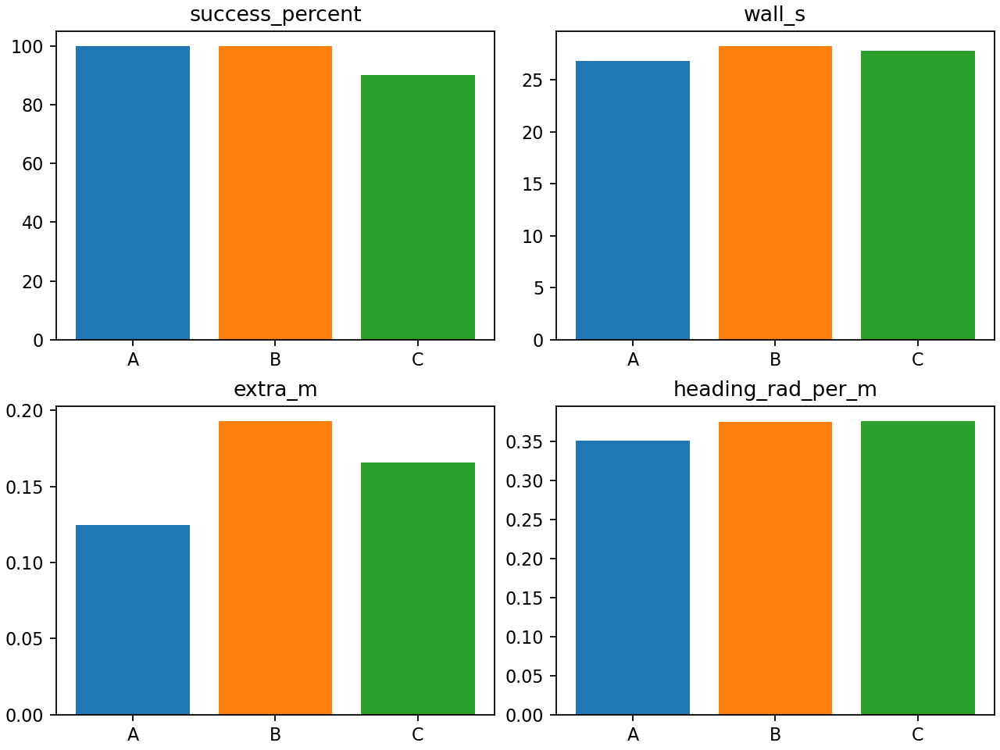
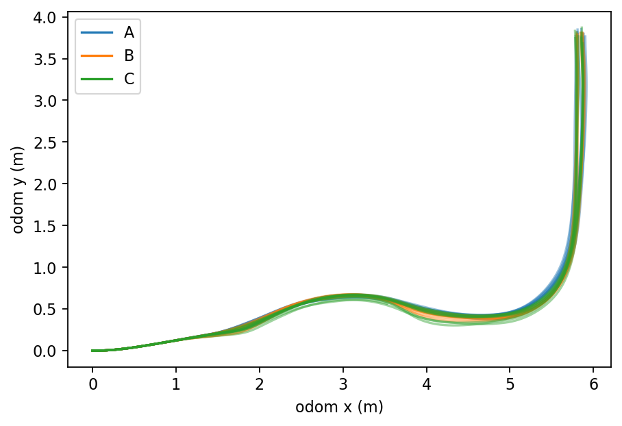

# M3-4 动态障碍避让实验报告

更新日期为 2026-11-22。以下采用用户在 Ubuntu 22.04、ROS 2 Humble、Gazebo Classic 上完成的 0.80 m 方块实验。来源为上传的 M3-4_box080_results.tar.gz，逐轮原始 CSV、失败日志摘录及图表保存在 [本次数据目录](results/box080/)。旧版 0.40 m 实验保存在 [历史报告](results/report_box040.md)，历史数据保留原尺寸含义。

## 一、同一条走廊中，哪组参数表现更好？

起点、地图及目标固定，目标为地图坐标 (6, 4)，朝向 π/2。方块为 0.80 × 0.80 × 0.80 m，在车驶离初始里程计位置 0.05 m 后等待 3 个仿真秒，注入世界坐标 (3, −4)。两套对照方案均为 MPPI，A/B 只改变 FollowPath.CostCritic.cost_weight，分别为 3.81 和 7.62，B 为加倍障碍代价的方案；C 为后续中间权重调优。

| 方案 | 权重 | 尝试数 | 有效注入 | 到达 | 成功率 | 成功平均耗时 (s) | 绕行额外路径 (m) | 航向变化 (rad/m) |
| --- | ---: | ---: | ---: | ---: | ---: | ---: | ---: | ---: |
| A | 3.81 | 11 | 10 | 10 | 100% | 26.808 | 0.12449 | 0.35088 |
| B | 7.62 | 10 | 10 | 10 | 100% | 28.242 | 0.19300 | 0.37507 |
| C，B 调优后 | 5.715 | 11 | 10 | 9 | 90% | 27.766 | 0.16589 | 0.37638 |

[汇总 CSV](results/box080/summary.csv) 中每项均值都注明样本数。A/B 各为 10 个成功样本，C 为 9 个成功样本。成功率分母为本轮成功生成障碍的有效尝试数。A05 目标应答超时、C09 控制器参数服务超时均保留，不计入有效注入分母。C08 有效注入后 ABORTED，计为避障失败。

本场景选 A。A 相比 B 平均快 1.433 s，少绕 0.06852 m，每米累计航向变化少 0.02419 rad/m。十次全部到达只描述本场景的观察结果，尚未测量连续障碍间距或其他地图的成功率。

距离由目标 UUID 对应的 EXECUTING 到终态窗口内里程计轨迹积分。绕行额外路径减去既有同路线无障碍实测基线 8.7051282 m。本次核对了全部 30 个有效注入轮次的轨迹与逐轮里程一致。平滑度采用相邻航向差回绕至 ±π 后的绝对值累计除以路程。耗时取目标被接受至客户端收到结果的墙钟时间。

## 二、方案在什么条件下观察到失效？

把障碍位置移近到世界坐标 (2, −4)，保持 A、0.80 m 尺寸和起步后 3 秒注入，两次均 ABORTED。两次耗时为 8.361 s、10.405 s。生成请求均在起步后 3.000 仿真秒发出，服务成功回复时最近一帧分别为 3.160 s、3.040 s。用户观察小车停住，未确认物理碰撞。

[两次近距离试验](results/box080/box080_failure/) 的日志都出现 Starting point in lethal space。该结论说明在这些试验中全局代价地图将规划起点判作不可通行。造成该代价的具体障碍、车体是否接触方块、临界注入距离，当前资料未能确定。

正式 C08 在 (3, −4) 也出现一次 ABORTED，表明同一位置存在运行差异。可作为历史失败案例讲解，现场失效演示优先使用已测两次的近处位置。

## 三、失效后全局重规划能否脱困？

C08 日志在 1795321503.077091303 起出现 no valid path found，1795321504.260529823 起出现 Starting point in lethal space，后续重复规划失败，1795321508.285021591 报 Goal failed。记录证明全局规划被多次调用，最终未脱困。两种报错首次出现相差约 1.183 s，这个间隔只反映错误日志时序。

本次上传含完整日志和逐轮轨迹；仓库保存精简证据。当前提供的日志没有确定局部失败的统一起点，也没有可确认的成功新路径，因此“局部失败到有效新路径发布”的延迟无可用测量值。两次近距离 A 试验也记录了全局规划失败和最终目标中止。

## 四、比赛场景如何配置？

针对当前限速 0.35 m/s、先直行再拐弯的走廊任务，选择 A，使用 Ackermann 模型、0.65 m 最小转弯半径、0.60 rad/s 角速度上限、CostCritic 权重 3.81。

为降低 B 的绕行和耗时，保持其余设置，只把 7.62 降到 A/B 中点 5.715，得到 C。C 的成功轮次平均比 B 快 0.476 s，少绕 0.02711 m，但每米累计航向变化增加 0.00131 rad/m，且有效试验成功率由 100% 变为 90%。本次调优没有带来整体改进，保留失败结果并选 A。

额外将 A 的障碍位置换为 (3.5, −4.2)，两次有效注入均成功，耗时 25.671 s 和 25.561 s；之前一次目标应答超时也保留在 [新位置试验](results/box080/box080_random_practice/)。这验证了通过参数改变位置的运行入口。考官现场指定的其他位置仍需实际运行。

## 展示材料状态

已有 20 次对照加 10 次调优的有效原始记录、四指标图、轨迹叠图、两次近处失效和新位置两次成功的日志。0.80 m 方块避障过程的四帧截图或录屏尚未包含在本次上传中。现场应展示接近、检测、绕行和通过四个阶段，并演示考官指定位置两次。
