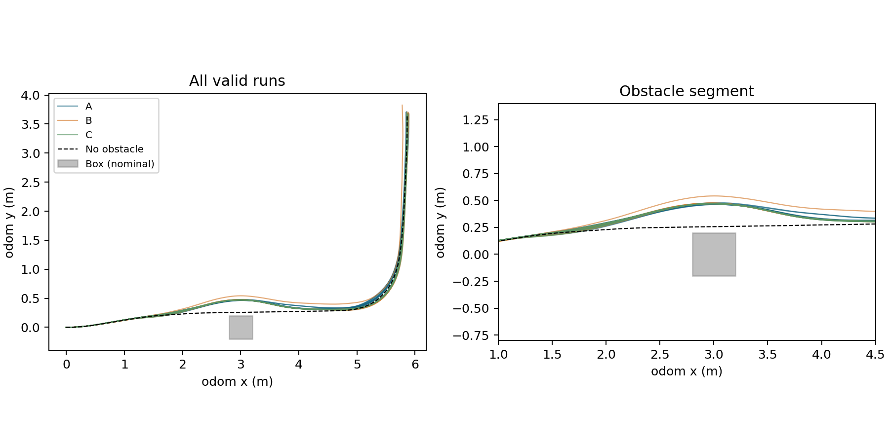
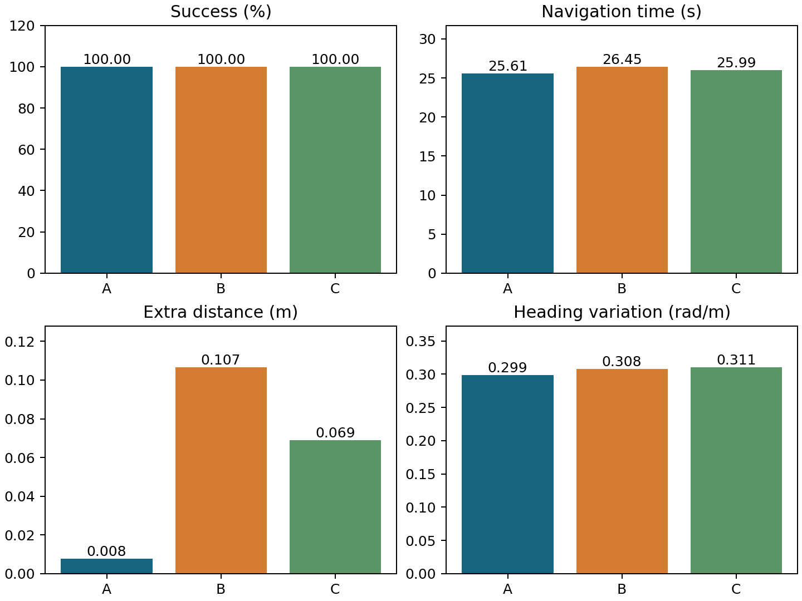
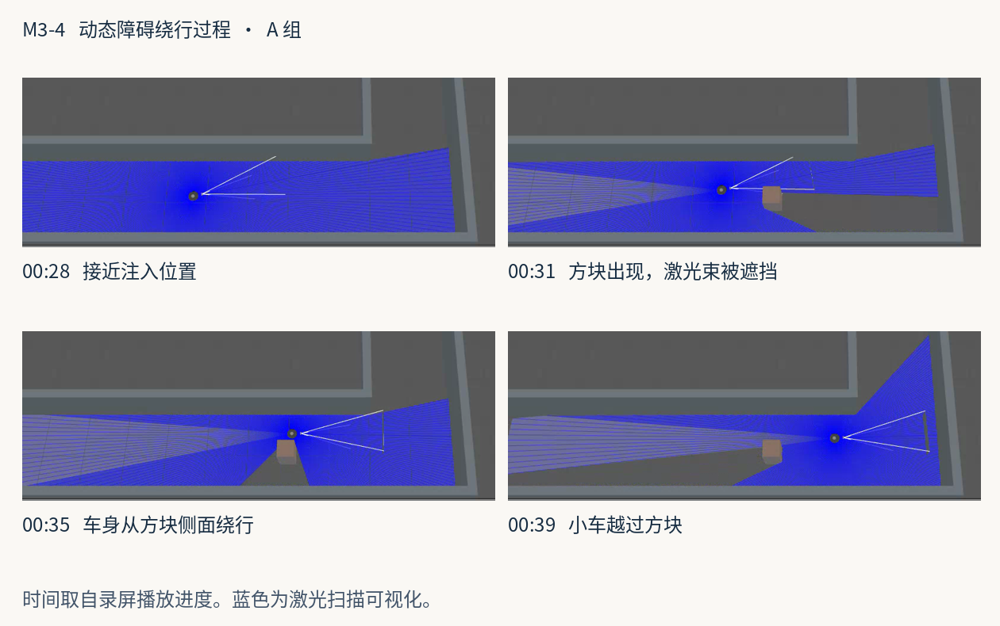

# M3-4 动态障碍避让实验报告

## 一、同一条走廊中，哪组参数表现更好？

在 ROS 2 Humble 和 Gazebo 中，阿克曼小车从地图原点驶向 (6, 4)，终点朝向 90°。小车驶离起点 5 cm 后开始计时，第 3 个仿真秒在世界坐标 (3, −4) 注入一个底面 0.40 m × 0.40 m、高 0.80 m 的方块。方块出现后保持静止。三组均采用 MPPI，仅调整障碍代价权重。

| 方案 | CostCritic.cost_weight | 成功到达 | 平均耗时 (s) | 行程 (m) | 绕行增量 (m) | 平滑度 (rad/m) |
|---|---:|---:|---:|---:|---:|---:|
| A | 3.81 | 10/10 | 25.607 | 8.713 | 0.008 | 0.2990 |
| B | 7.62 | 10/10 | 26.450 | 8.812 | 0.107 | 0.3078 |
| C，B 调优后 | 5.715 | 10/10 | 25.993 | 8.774 | 0.069 | 0.3106 |

在本场景选 A。三组均到达目标，A 平均每轮比 B 快 0.843 s，少走 0.099 m，每米累计转向也最少。将 B 的权重降至两端的中点后，C 平均每轮节省 0.457 s、少走 0.038 m，平滑度指标增加 0.0028 rad/m。该结果适用于这条走廊和本次注入位置，三组的车身最小障碍间距尚未测量。

每轮按目标 UUID 截取动作执行至终止期间的平面里程计轨迹。绕行增量等于该轮行程减去一次无障碍实测的 8.705 m。平滑度为相邻航向角差回绕至 ±π 后的绝对值之和除以行程。耗时为目标接受至客户端收到结果的墙钟时间。成功率分母为注入成功的有效轮次，平均耗时只取成功轮次。

32 个轮次目录均保留。B04 已到达，C03 在 5.73 s 时中止，两次注入均返回实体已存在，统一排除。B11、C11 补足有效样本。C10 取匹配录包目标 UUID 的首次导航 25.97 s，额外发送的 0.071 s 请求单独保留。

## 二、在什么条件下观察到失效？

相同路线将方块中心移至 (2, −4) 后，三次调试均中止。第一轮车身侧翻，横滚约 1.571 rad。第二轮车身直立，9.74 s 后返回 ABORTED。第三轮生成回复时的纵向余量约 0.72 m；改到 (3, −4) 的第四轮约 1.66 m，小车绕过方块，25.67 s 后到达。该余量从车体参考点量至方块近侧面。离散测试显示近处突然出现方块时更难恢复；精确临界距离、首先接触的物体及接触时刻尚未确定。

## 三、局部失败后，全局重规划能否脱困？

第一轮近距离试验中，控制器在时间戳 1794995945.022636 报出 MPPI 求解失败。全局规划器在 1794995945.815748 报告重规划起点处于致命代价区，相隔 0.793 s。日志显示全局规划共四次失败，目标最终中止。0.793 s 表示两条错误日志之间的墙钟时间；由于重规划没有产生有效新路径，这一轮的“失败到新路径发布”延迟无可用值。

## 四、比赛场景如何配置？

对限速 0.35 m/s、前进通过走廊并转弯的任务，选用 A 组：Ackermann 运动模型、最小转弯半径 0.65 m、角速度上限 0.60 rad/s、CostCritic 权重 3.81。现场演示在起步后 3.000 个仿真秒请求注入，服务于最近一帧 3.020 s 时已返回成功，随后导航成功。现场指定其他位置时使用世界坐标参数重新注入。更窄的通道和持续移动的障碍物仍需分别测试。

